<p align="center">
  <a href="https://jsencinas.github.io/">
    
  </a>
</p>

<p align="center">
  <a href="https://jsencinas.github.io/"></a>
  <a href="https://www.linkedin.com/in/jsencinas"></a>
  <a href="mailto:jesanchezencinas@gmail.com"></a>
  
</p>

### `~/now`

I like software that has to **answer right away**: a robot with seconds left in a match, a model scoring live audio.
Now I want to learn how systems like these hold up when someone tries to break them.

- 🏆 **Latest:** HackMTY 2026 finalist, **4th of 38 teams**, with *Synthia*
- 🛡️ **Learning:** penetration testing on Hack The Box
- 🎓 **Studying:** B.S. in Computer Science and Technology, Tec de Monterrey (GDL), class of 2029

### `~/projects`

```console
jorge@gdl:~$ ls projects/
```

| | Project | What it does | Stack |
|---|---|---|---|
| `01` | **[Synthia](https://github.com/jsencinas/Synthia_hackmty26)**<br><sub>HackMTY 2026 · 4th of 38</sub> | Tells in real time whether a banking call comes from a person or an AI voice agent. Three layers: turn-taking dynamics, acoustic metrics, and a stacked XGBoost + logistic regression ensemble. **81/81 calls** on the live benchmark, **1.15 s** average latency. I built the cascade model and secured the Linux server. | `python` `xgboost` `fastapi` `cloudflare tunnels` |
| `02` | **[Autexa](https://github.com/jsencinas/autexa-customer-follow-up)**<br><sub>Client project · 2026</sub> | A customer follow-up CRM I built and deployed for a client. It sends WhatsApp satisfaction surveys after each service, reads inspection forms with a local vision model, sorts replies with rules plus a local LLM, and rejects any webhook call that Meta did not sign. | `python` `fastapi` `sqlalchemy` `ollama` |
| `03` | **[FIRST Robotics 7102](https://github.com/Daedalus7102)**<br><sub>2023 – 2025</sub> | Lead programmer and primary driver. Wrote the autonomous and teleoperated code and drove it in live matches. 2024 World Championship in Houston, Autonomous Award (2024), Innovation in Control Award (2025). | `java` `wpilib` |
| `04` | **[6-DOF robotic arm](https://github.com/jsencinas/Robotic_arm-Coordinates_based)**<br><sub>Solo · 2024</sub> | Inverse kinematics from an (x, y, z) target to joint angles, on modular C++ libraries for joint interpolation and hardware abstraction. | `c++` `arduino` `python` |
| `~` | **[dotfiles](https://github.com/jsencinas/dotfiles)** | My Arch Linux setup: Neovim, Zsh, Tmux and Ghostty, managed with GNU Stow. | `lua` `zsh` |

### `~/skills`

<p>
  <br/>
  
</p>

### `~/about`

- 🏠 **Techo Jalisco:** on-site volunteer lead on 14 transitional housing builds, directing teams of 15. Vice President of Techito (2024).
- 🥁 Drummer and musician
- 🏃 Running and fitness
- 🗣️ Spanish (native), English (B2)

### `~/stats`

<p align="center">
  
  
</p>

<p align="center">
  
</p>
