  

  
  
  
  

### `~/now`

I like software that has to **answer right away**: a robot with seconds left in a match, a model scoring live audio.
Now I want to learn how systems like these hold up when someone tries to break them.

- 🏆 **Latest:** HackMTY 2026 finalist, **4th of 38 teams**, with *Synthia*
- 🛡️ **Learning:** penetration testing on Hack The Box
- 🎓 **Studying:** B.S. in Computer Science and Technology, Tec de Monterrey (GDL), class of 2029

### `~/projects`

<pre>
jorge@gdl:~$ tree -L 1 projects/
projects/
├── <a href="https://github.com/jsencinas/Synthia_hackmty26">synthia/</a>
├── <a href="https://github.com/jsencinas/autexa-customer-follow-up">autexa/</a>
├── <a href="https://github.com/Daedalus7102">frc-7102/</a>
├── <a href="https://github.com/jsencinas/Robotic_arm-Coordinates_based">robotic-arm/</a>
└── <a href="https://github.com/jsencinas/dotfiles">dotfiles/</a>

5 directories, 0 files
</pre>

### `~/skills`

   
  

### `~/stats`

  

  

